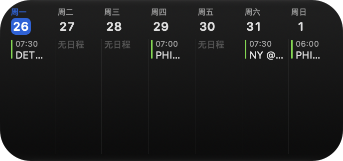
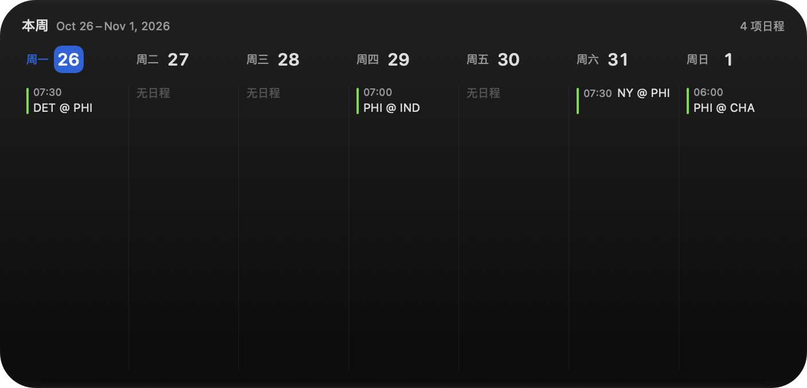

# Itsycal（桌面日程小组件分支）

基于 [Itsycal](https://github.com/sfsam/Itsycal) 的独立分支，增加两个原生 macOS 桌面小组件：“本周日程”一眼看到本周七天的安排，“本月日程”显示整月日历。

| 中号 | 超大号 |
| --- | --- |
|  |  |

## 功能

- 本周日程有中号和超大号；本月日程为超大号，每格显示当天的事件，放不下时显示“+N”。
- 顶栏显示范围与日程总数；`›` 切到下周/下月、`‹` 回到本周/本月，不打开主应用；切换 15 分钟后自动回来。
- 七列显示当前一周，日期排列**跟随 Itsycal 设置中的“一周从周几开始”**。
- 在设置 → Appearance 修改“一周从周几开始”后，主应用会重新生成共享数据并请求小组件刷新，无需重建。
- 今天突出显示；已过去的日期和其下列表整列变暗。
- 每天最多显示四项（中号三项），超出显示“还有 N 项”，点击进入主应用查看完整当天。
- 支持全天事件、跨日事件、重复事件和本地时区/夏令时。
- 跟随系统浅色/深色外观。日历数据只保存在本机。

## 系统要求

当前工程要求 **macOS 27 / Xcode 27**。WidgetKit 本身支持更早系统，但基础代码来自要求 macOS 27 的上游版本，尚未在旧系统验证。

## 构建与安装

```sh
cp -n Local.xcconfig.example Local.xcconfig   # 填入自己的团队、Bundle ID 与 App Group
bash Scripts/install-week.sh
```

仓库不含我们的证书或私钥，任何人都用自己的 Apple 身份构建。签名配置、安装脚本的行为与排查见 [构建、安装与排查](docs/WEEK_WIDGET_SETUP.md)。

安装后：

1. 打开 Itsycal，允许日历访问。
2. 在设置 → Events 中选择要显示的日历。
3. 桌面右键 → 编辑小组件 → 搜索 Itsycal → 添加“本周日程”（中号/超大号）或“本月日程”（超大号）。

主应用退出后小组件仍显示已有快照，但新的日程修改要等主应用再次运行才同步。

## 版本号

- `MARKETING_VERSION`（用户看到的版本）在 `Itsycal.xcodeproj/project.pbxproj` 的两个 target 中设置。
- `CURRENT_PROJECT_VERSION` 是默认 build 号。
- 主应用和 Widget 的 `Info.plist` 使用 `$(MARKETING_VERSION)` / `$(CURRENT_PROJECT_VERSION)`。
- 本地安装脚本会用当前时间覆盖 build 号，避免 WidgetKit 继续使用旧版本的时间线归档。

## 检查

```sh
bash Tests/check-week.sh
```

检查使用合成数据，不读取个人日历；覆盖范围见[规格第 7 节](docs/WEEK_WIDGET_SPEC.md#7-验证)。

## 上游与许可

本项目从 [sfsam/Itsycal](https://github.com/sfsam/Itsycal) 的 `1a31050555a97e3b7aac5470ec147abfe7aa0d6a`（0.27.3）派生，之后独立演进，不再自动合并上游。

原始代码采用 MIT 许可，版权归 © 2016 Sanjay Madan；详见 [LICENSE.txt](LICENSE.txt)。本项目保留原作者署名，新增的周视图与安装代码由 wutongyuonce 维护。

更多细节：

- [行为与架构说明](docs/WEEK_WIDGET_SPEC.md)
- [安装、刷新排查与真机验收](docs/WEEK_WIDGET_SETUP.md)
