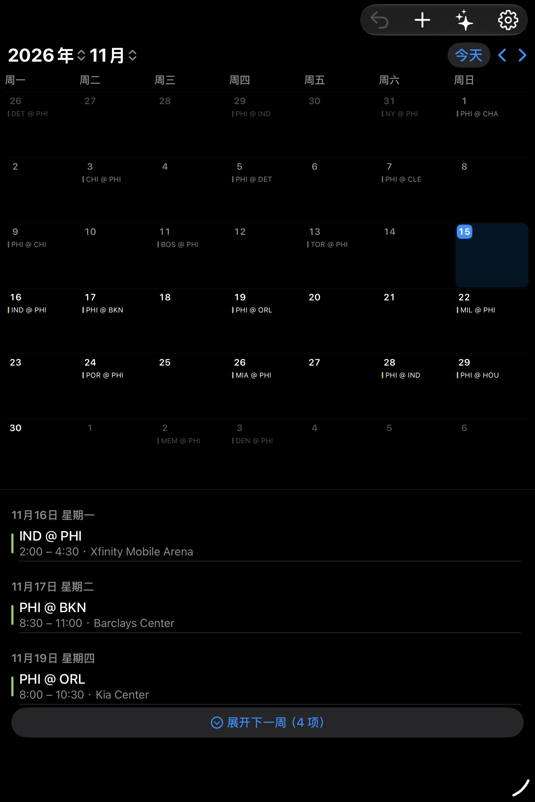
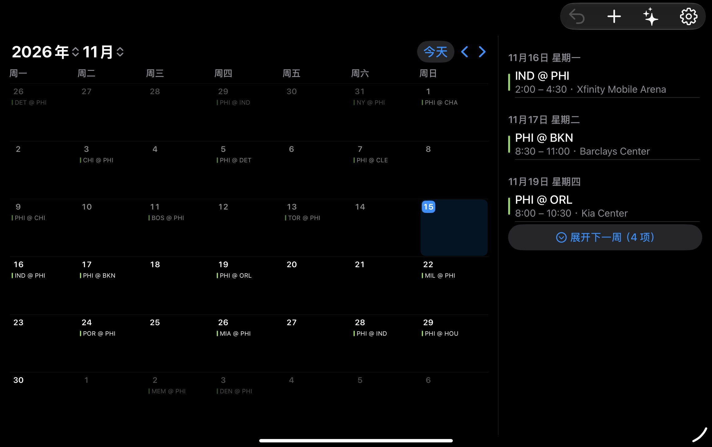
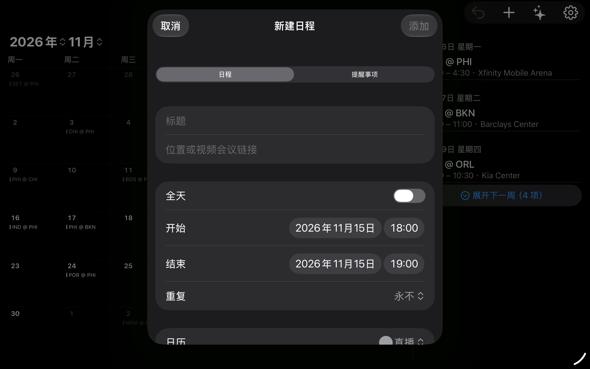
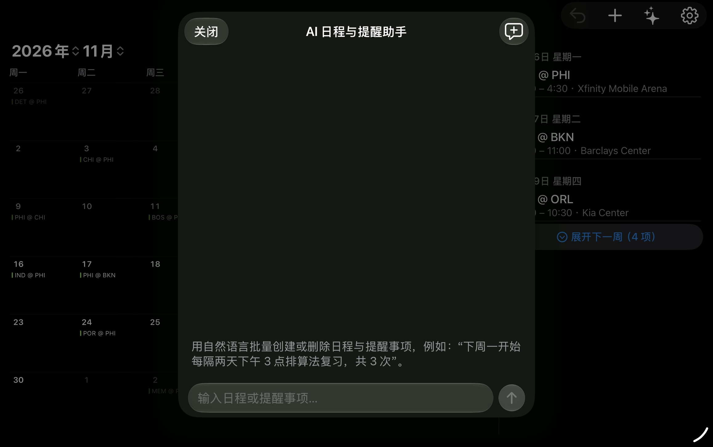
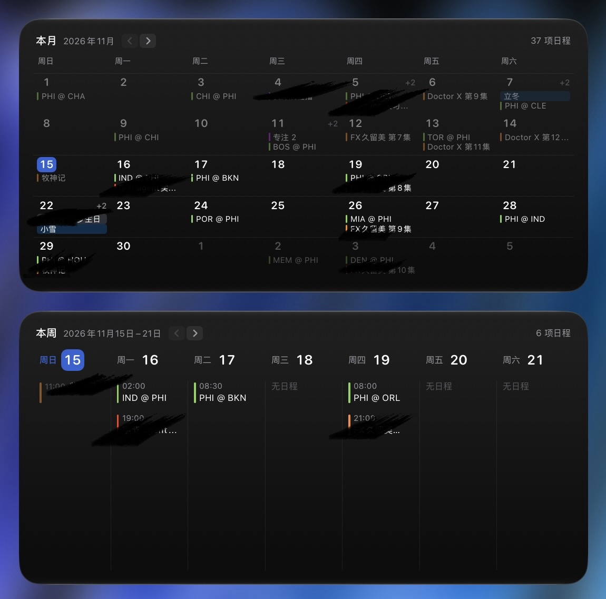

# Itsycal

Mac 菜单栏日历，以及 iPhone、iPad 上的日程应用。

这是 [Itsycal](https://github.com/sfsam/Itsycal) 的增强版。上游那个轻量的菜单栏日历都还在，并在 **Mac、iPhone、iPad** 上补了同一套能力：月历里直接看日程和提醒、新建与编辑、用自然语言批量处理的 AI 助手，以及周视图 / 月视图小组件。

## 界面

iPhone 和 iPad 用同一套布局：竖屏是月历在上、议程在下；横屏（以及够宽的分屏窗口）是月历在左、议程在右。

<p align="center">
  
  &nbsp;&nbsp;
  
</p>

点 `+` 新建一条日程或提醒事项，点 `✦` 用一句话排一批。AI 会先列出将要新增或删除的条目，确认后才写入系统日历。

<p align="center">
  
  &nbsp;&nbsp;
  
</p>

主屏幕小组件是「本月日程」和「本周日程」。Mac 桌面上的小组件是同一套外观。

<p align="center">
  
</p>

## Mac

菜单栏里的 Itsycal：弹出月历和议程，保留上游的外观、日历选择和快捷键。在此之上：

- **桌面小组件**：「本周日程」有中号和超大号，「本月日程」有超大号。顶栏显示当前周或月以及条目数；`›` 翻到下一周/月，`‹` 回到当前，15 分钟后自动回来，不用打开主应用。点某一天会在 Itsycal 里打开当天。一周从哪天开始，跟随 Itsycal 设置。
- **新建、编辑、删除**：`+` 或 `⌘N` 新建，表单里切换「日程」和「提醒事项」。点议程里的条目，或用右键菜单，可以编辑或删除。`⌘Z` / `⇧⌘Z` 多级撤销和重做。
- **AI 助手**：`✦` 或 `⌘K` 从主窗口左侧打开。重新打开会续接上次对话，也可以新建、切换历史会话，或让 AI 去检索以前的会话。
- **干净卸载**：`设置 › 关于` 里的「干净卸载 Itsycal…」会清掉开机启动项、偏好设置、钥匙串里的 API Key、AI 缓存和小组件容器，再把应用移入废纸篓。

细节见 [Mac 端新建与编辑](docs/MAC_EDITING_SPEC.md)、[桌面小组件](docs/WEEK_WIDGET_SPEC.md)。

## iPhone 与 iPad

同一 Xcode 工程里的原生应用 `ItsycalMobile`，不是 Mac 版的套壳。日历和提醒都来自系统，不另建一份数据。

- **月历**：格内直接显示日程和提醒。今天高亮，非本月和已经过去的日期变淡，放不下的用 `+N`。年份和月份可以点开直接选，也可以滑到相邻月份。
- **议程**：从选中的那天往后列。底部可以继续展开；下一周是空的会直接跳到再后面有内容的那一周，并注明跳过了多少天。过去的日程变淡，逾期还没完成的提醒变红。
- **新建与编辑**：点议程里的任一条目就地修改。新建时在表单顶部切换日程或提醒事项，可设全天、起止时间、重复和所属日历。重复条目在保存或删除时会问「仅此一次」还是「以后全部」。
- **撤销**：顶栏按钮或 `⌘Z` 都会先说明这次要撤回什么，确认后才执行。只在本次运行期间有效，移动端没有重做。
- **外接键盘**：`⌘N` 新建，`⌘K` 打开 AI，`⌘T` 回到今天，`⌘←` / `⌘→` 切换月份。
- **主屏幕小组件**：和 Mac 同一套「本周日程」「本月日程」。iPhone 的月视图是大号；iPad 另外有超大号周视图和月视图。`‹ ›` 翻页，15 分钟后回到当前周期。点某一天会打开 App 并选中那一天。

免费的个人开发者账号不能使用 iOS App Group，所以 iPhone / iPad 上的小组件自己读日历：显示全部日历，一周从哪天开始跟随系统，不读 App 里的这两项设置。付费账号同样如此，小组件不走 App Group。

架构和交互契约见 [iOS / iPadOS 规格](docs/IOS_APP_SPEC.md)。

## AI 助手

Mac、iPhone、iPad 共用同一份 AI 代码。

- 在设置里填写协议、接口地址、模型和 API Key。支持 **OpenAI 兼容接口**（OpenAI、DeepSeek、硅基流动、OpenRouter、本地 Ollama 等）、**Anthropic (Claude)** 和 **Google Gemini**。API Key 只放在系统钥匙串里。
- 用自然语言创建或删除日程和提醒，包括按周期批量排期。AI 在本地沙箱里查询已有条目并检查时间冲突，不会直接改日历。
- 待处理的条目先显示成确认清单，可以单条勾选或取消，也可以继续说话让它改。点「确认执行」后才写入。
- 执行结果留在会话里。设置中可以查看缓存占用并一键清除会话。

契约见 [AI 助手规格](docs/AI_ASSISTANT_SPEC.md)。

## 系统要求

当前工程要求 **macOS 27 / iOS 26+ / Xcode 27**。

## 构建与安装

```sh
cp -n Local.xcconfig.example Local.xcconfig   # 填入自己的团队、Bundle ID 与 App Group
bash Scripts/install-week.sh
```

仓库不含个人证书或私钥，任何人都用自己的 Apple 身份构建。签名配置、安装脚本的行为与排查见 [构建、安装与排查](docs/WEEK_WIDGET_SETUP.md)。

**开发者账号**：普通 Apple ID（免费个人团队）即可构建全部功能。Mac 版长期可用；iPhone / iPad 版由 Xcode 直接安装（⌘R），免费签名 **7 天后失效**需重新安装，且免费个人团队不支持 iOS App Group。付费账号的签名 1 年有效、可分发。各情况的区别见[开发者账号与签名](docs/WEEK_WIDGET_SETUP.md#开发者账号与签名)，iOS 安装步骤见[安装到 iPhone / iPad](docs/WEEK_WIDGET_SETUP.md#安装到-iphone--ipad)。

Mac 版安装后：

1. 打开 Itsycal，允许日历（及提醒事项）访问。
2. 在 `设置 › 事件` 中选择要显示的日历与提醒事项列表。
3. 在 `设置 › AI` 中配置大模型协议、接口地址、模型与 API Key，即可按 `⌘K` 使用 AI 助手。
4. 桌面右键 → 编辑小组件 → 搜索 Itsycal → 添加「本周日程」（中号/超大号）或「本月日程」（超大号）。

iPhone / iPad：用 Xcode 打开工程，选中 `ItsycalMobile`，连上设备后 ⌘R。装好后到主屏幕添加「本周日程」或「本月日程」。

## 版本号

- `MARKETING_VERSION`（用户看到的版本）和 `CURRENT_PROJECT_VERSION` 设在 `Itsycal.xcodeproj/project.pbxproj` 的工程级，主应用和 Widget 继承同一个值，保证版本一致；不要在 target 里单独改。
- `CURRENT_PROJECT_VERSION` 是默认 build 号。
- 主应用和 Widget 的 `Info.plist` 使用 `$(MARKETING_VERSION)` / `$(CURRENT_PROJECT_VERSION)`。
- 本地安装脚本会用当前时间覆盖 build 号，避免 WidgetKit 继续使用旧版本的时间线归档。

## 检查

```sh
bash Tests/check-week.sh
```

检查使用内存合成数据，不读取或修改个人真实日历；覆盖完整桌面扩展类型检查、周/月视图结束变暗的真实渲染、小组件模型与时间线可见容量、AI 多协议客户端、CodeMode 沙箱、移动端日历规则与 iOS 小组件快照、安装脚本以及 `EventCenter` 缓存与批量增删 Undo/Redo。

## 上游同步与许可

本项目派生自 [sfsam/Itsycal](https://github.com/sfsam/Itsycal)，**会定期同步合并上游最新特性与修复**（当前已同步至上游 `0.29.0` `287576c`），同时维护桌面小组件、AI 日程助手与 iPhone / iPad 应用。

原始代码采用 MIT 许可，版权归 © 2012–2026 Sanjay Madan；详见 [LICENSE.txt](LICENSE.txt)。本项目保留原作者署名，新增功能由 wutongyuonce 维护。

更多细节：

- [AI 自然语言日程助手规格与设计契约](docs/AI_ASSISTANT_SPEC.md)
- [Mac 端新建与编辑日程、提醒事项规格](docs/MAC_EDITING_SPEC.md)
- [iOS / iPadOS 端规格与设计契约](docs/IOS_APP_SPEC.md)
- [桌面小组件行为与架构说明](docs/WEEK_WIDGET_SPEC.md)
- [安装、刷新排查与真机验收](docs/WEEK_WIDGET_SETUP.md)
