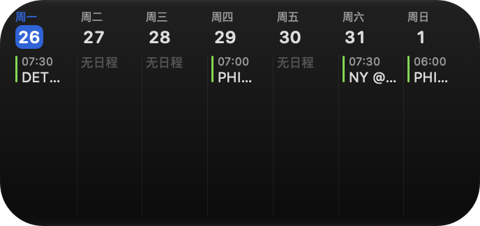
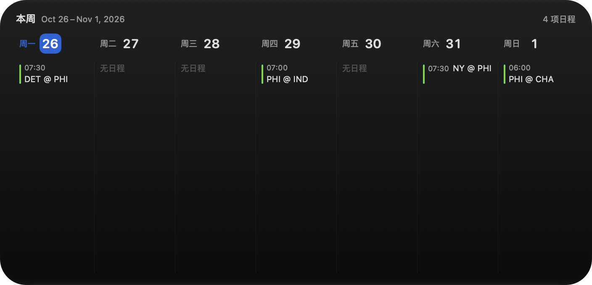
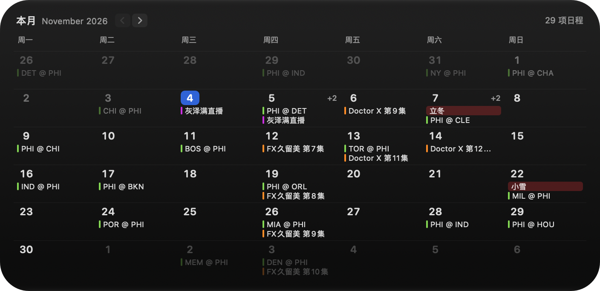

# Itsycal（桌面小组件与 AI 日程助手增强版）

基于 [Itsycal](https://github.com/sfsam/Itsycal) 持续同步上游演进的增强版分支，在保留上游全部轻量体验的基础上，新增**原生 macOS 桌面周/月视图小组件**与 **CodeMode AI 自然语言日程 & 提醒事项助手**。

| 中号周视图 | 超大号周视图 | 超大号月视图 |
| --- | --- | --- |
|  |  |  |

## 功能

### 1. CodeMode AI 日程与提醒事项助手
- **多协议支持**：在 `设置 › AI` 中支持配置 **OpenAI Compatible**（OpenAI / DeepSeek / 硅基流动 / OpenRouter / 本地 Ollama 等）、**Anthropic (Claude)** 与 **Google Gemini** 的 `API URL`、`Model` 与 `API Key`（API Key 仅加密保存在 macOS Keychain 中）。
- **自然语言批量增删（事件 & 提醒事项）**：在主窗口点击左下角 `✨` 按钮或按 `⌘K` 即可在主窗口左侧拉起 AI 助手小窗，支持用自然语言创建、按复杂周期批量排期或删除**日历事件（`EKEvent`）**与**提醒事项（`EKReminder`）**。
- **JavaScriptCore 沙箱与全量历史查询**：AI 通过内置内存隔离的 `JSContext` 沙箱执行工具调用，支持跨任意历史/未来年份查询已有日程与提醒、自动检测时间冲突。
- **可视化确认清单与多级撤销**：所有待新增或待删除的日程/提醒都会先在对话小窗中生成预览卡片（支持单项勾选/取消、冲突提醒、或继续发话微调）；点击**「确认执行」**后才原子化提交到系统日历，并在主窗口支持按 `⌘Z` / `⇧⌘Z` 多级撤销与重做。
- **缓存管理与干净卸载**：`设置 › AI` 支持查看并一键清理会话历史与缓存；`设置 › 关于` 提供**「干净卸载 Itsycal…」**按钮，可一键清理开机启动项、偏好设置、Keychain 密钥、AI 缓存及小组件容器并移入废纸篓。具体契约见 [AI 助手规格与设计契约](docs/AI_ASSISTANT_SPEC.md)。

### 2. 原生桌面周视图与月视图小组件
- **本周日程**提供中号和超大号；**本月日程**提供超大号月视图。月视图按周排列成 7 列，覆盖整月的完整周（通常 4–6 行），并显示前后相邻月份的日期。
- 月视图每格显示日期与可容纳的日程；当天高亮，非本月日期和过去日期变暗，超出格内空间的日程用 `+N` 标记。点击某一天可在 Itsycal 中查看当天完整日程。
- 顶栏显示当前周/月与日程总数；`›` 切到下周/下月、`‹` 回到本周/本月，不打开主应用；一段时间后自动返回当前周/月。
- 周视图和月视图的星期排列都**跟随 Itsycal 设置中的“一周从周几开始”**。
- 支持全天事件、跨日事件、重复事件、未完成提醒事项和本地时区/夏令时，跟随系统浅色/深色外观。具体行为见[桌面小组件规格](docs/WEEK_WIDGET_SPEC.md)。

### 3. iOS / iPadOS 移动端 (`ItsycalMobile`)
- 在同一 Xcode 工程中提供原生 iOS / iPadOS Target（`ItsycalMobile`），**零拷贝直接共享 `Itsycal/AIAssistant.swift`**（多协议客户端与 `JavaScriptCore` CodeMode 沙箱）。
- **以月视图为主的自适应界面**：月视图参照桌面月视图小组件，格内直接显示日程与提醒；窄窗口上下分栏、宽窗口（iPad、iPhone 横屏）左右分栏，点击议程中的任一条目即可编辑，支持多级撤销和外接键盘快捷键（`⌘N` 新建、`⌘K` AI 助手、`⌘T` 回到今天、`⌘Z` 撤销）。
- 具体架构与规格见 [iOS / iPadOS 端规格与设计契约](docs/IOS_APP_SPEC.md)。

## 系统要求

当前工程要求 **macOS 27 / iOS 26+ / Xcode 27**。

## 构建与安装

```sh
cp -n Local.xcconfig.example Local.xcconfig   # 填入自己的团队、Bundle ID 与 App Group
bash Scripts/install-week.sh
```

仓库不含个人证书或私钥，任何人都用自己的 Apple 身份构建。签名配置、安装脚本的行为与排查见 [构建、安装与排查](docs/WEEK_WIDGET_SETUP.md)。

安装后：

1. 打开 Itsycal，允许日历（及提醒事项）访问。
2. 在 `设置 › 事件` 中选择要显示的日历与提醒事项列表。
3. 在 `设置 › AI` 中配置大模型协议、接口地址、模型与 API Key，即可按 `⌘K` 使用 AI 助手。
4. 桌面右键 → 编辑小组件 → 搜索 Itsycal → 添加“本周日程”（中号/超大号）或“本月日程”（超大号）。

## 版本号

- `MARKETING_VERSION`（用户看到的版本）和 `CURRENT_PROJECT_VERSION` 设在 `Itsycal.xcodeproj/project.pbxproj` 的工程级，主应用和 Widget 继承同一个值，保证版本一致；不要在 target 里单独改。
- `CURRENT_PROJECT_VERSION` 是默认 build 号。
- 主应用和 Widget 的 `Info.plist` 使用 `$(MARKETING_VERSION)` / `$(CURRENT_PROJECT_VERSION)`。
- 本地安装脚本会用当前时间覆盖 build 号，避免 WidgetKit 继续使用旧版本的时间线归档。

## 检查

```sh
bash Tests/check-week.sh
```

检查使用内存合成数据，不读取或修改个人真实日历；覆盖小组件模型、AI 多协议客户端、CodeMode 沙箱、安装脚本以及 `EventCenter` 缓存与批量增删 Undo/Redo。

## 上游同步与许可

本项目派生自 [sfsam/Itsycal](https://github.com/sfsam/Itsycal)，**会定期同步合并上游最新特性与修复**（当前已同步至上游 `0.29.0` `287576c`），同时维护桌面小组件、AI 日程助手与跨端扩展能力。

原始代码采用 MIT 许可，版权归 © 2012–2026 Sanjay Madan；详见 [LICENSE.txt](LICENSE.txt)。本项目保留原作者署名，新增功能由 wutongyuonce 维护。

更多细节：

- [AI 自然语言日程助手规格与设计契约](docs/AI_ASSISTANT_SPEC.md)
- [iOS / iPadOS 端规格与设计契约](docs/IOS_APP_SPEC.md)
- [桌面小组件行为与架构说明](docs/WEEK_WIDGET_SPEC.md)
- [安装、刷新排查与真机验收](docs/WEEK_WIDGET_SETUP.md)
