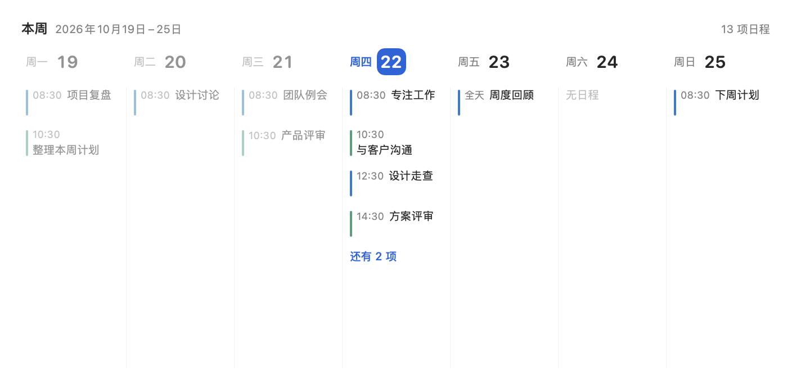

# Itsycal Week

A personal fork of [sfsam/Itsycal](https://github.com/sfsam/Itsycal) with a native macOS desktop widget showing the current week, Monday through Sunday.



- Seven fixed day columns using the calendars selected in Itsycal.
- Medium and extra-large widget sizes. Medium uses a compact layout; extra-large includes the week range and event count.
- Today is highlighted; past days and their events are dimmed.
- Up to four events per day. An overflow link opens the full day in the menu-bar app.
- All-day and multi-day events, light/dark appearance, and local-time week transitions.

The fork uses a separate app identity and URL scheme so it can coexist with the official Itsycal. Official Sparkle updates are disabled. Calendar data stays on the Mac. Keep the containing app running to sync event changes; WidgetKit controls the actual refresh timing.

## Build and install

The current upstream baseline requires **macOS 27 and Xcode 27**. Configure your own development signing in the ignored `Local.xcconfig`:

```sh
cp -n Local.xcconfig.example Local.xcconfig
```

Select Apple Development signing and use a macOS app group matching your team, such as `TEAMID.com.local.ItsycalWeek`. Never commit your local signing file or certificates. See [setup instructions](docs/WEEK_WIDGET_SETUP.md) for details.

Build and install the development app:

```sh
bash Scripts/install-week.sh
```

The script replaces `/Applications/Itsycal Week.app`, verifies its signature, and stops the old app and widget processes before replacement, then refreshes the per-user widget service. Other widgets briefly reload during installation. Open the app, grant calendar access, select calendars in Events settings, then add **本周日程** from the desktop widget gallery.

For a source-only build without signing:

```sh
xcodebuild -project Itsycal.xcodeproj -scheme Itsycal -configuration Debug \
  -destination 'platform=macOS' -derivedDataPath /tmp/itsycal-week-build \
  CODE_SIGNING_ALLOWED=NO build
```

This checks compilation; it does not establish that the widget can run on your Mac.

## Keep up with upstream

`master` stays aligned with upstream. The widget implementation lives on **feature/week-widget**.

In this checkout, `origin` is your fork and `upstream` is `https://github.com/sfsam/Itsycal.git`. After cloning the fork elsewhere, add upstream once:

```sh
git remote add upstream https://github.com/sfsam/Itsycal.git
```

From a clean feature branch, run:

```sh
git switch feature/week-widget
bash Scripts/sync-upstream.sh
```

This fetches upstream, fast-forwards the fork's master when safe, merges upstream into the widget branch, runs the offline checks and an unsigned build, then pushes the feature branch. It never force-pushes. Conflicts stop the script for manual resolution. Syncing source does not update the installed app; rerun the install script afterwards.

This is an on-demand sync command, not a scheduled background task.

## Checks and design

```sh
bash Tests/check-week.sh
```

The checks cover Monday-based dates, DST, week coverage, four-item capacity, links, overlapping EventKit queries, and cross-midnight grouping using synthetic data.

- [Behavior and architecture](docs/WEEK_WIDGET_SPEC.md)
- [Installation and refresh troubleshooting](docs/WEEK_WIDGET_SETUP.md)
- [Original upstream README](README.txt)

MIT licensed; see [LICENSE.txt](LICENSE.txt). Original Itsycal by Sanjay Madan / mowglii.com.
