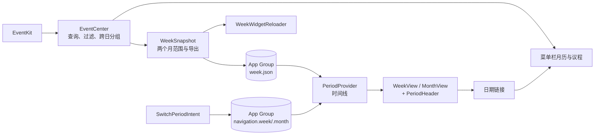

# Itsycal：桌面小组件规格

本文是桌面小组件的现行行为契约。代码与本文冲突时以代码为事实，并同步修正本文。构建、安装与排查见 [WEEK_WIDGET_SETUP.md](WEEK_WIDGET_SETUP.md)。

上游基线：`sfsam/Itsycal` `1a31050555a97e3b7aac5470ec147abfe7aa0d6a`（0.27.3）。要求 macOS 27 / Xcode 27。

## 1. 范围与非目标

- 两个原生 macOS 桌面小组件，显示 Itsycal 已选日历中的日程，不做小时网格：
  - **本周日程**：包含今天的一周七天，按天分列。
  - **本月日程**：包含今天的整月，按周分行。
- 第一列跟随 Itsycal 的“一周从周几开始”（`WeekStartDOW`，0=周日…6=周六）。
- 顶栏可切换到下一周/下个月并返回。
- 非目标：翻到下一周期以外、提醒事项、完成勾选、事件编辑、农历或节气、小组件内滚动、独立于主应用的日历配置、`systemLarge` / `systemMedium` 月视图。

## 2. 布局

本周日程支持 `systemMedium`（约 344 × 164 pt）和 `systemExtraLarge`（约 704 × 344 pt），本月日程只支持 `systemExtraLarge`。按 WidgetFamily 选择样式，不按容器宽度猜测。已有实例不会自动改变尺寸。

**顶栏（两个小组件共用）：** 左侧为标题（本周/下周、本月/下月）与范围（周为日期范围，月为“年 月”；按扩展的语言格式化，可能是英文），紧随其右为 `‹ ›` 切换按钮，最右为该周期日程总数（月只统计所显示月份的日期，前后补齐的日期不计入；有提示时隐藏）。中号顶栏 16 pt 高、标题 11 pt、范围不含年份、总数写作“N 项”；超大号 18 pt、标题 12 pt、范围含年份、总数写作“N 项日程”。

**七列：** 中号星期在上、日期在下，8 pt 内容边距；超大号星期日期同行，16 pt 内容边距。今天以蓝色圆角日期标识，过去的日期整列 opacity 0.5，仍可点击。今天已结束的事件不单独变暗。

**每日列表：** 全天事件在前，随后按开始时间排列，开始时间相同时按标题、事件标识稳定排序。标题 10 pt 单行省略；中号时间 8 pt、上下排列、每行 25 pt；超大号时间 9 pt、放得下时同行、每行 36 pt。`WeekDates.capacity` 按列区实际高度计算（中号预留 46 pt、超大号 54 pt，每天最多四项）：中号每天显示三项，超大号四项。超出显示“还有 N 项”，没有事件显示“无日程”。

**跨日事件：** 每个覆盖日独立显示，不画跨列长条。月视图在每个覆盖日重复只有标题的条目，不加延续标记。周视图中，全天跨日显示“全天”；计时跨夜起始日显示 `22:00 →`，完整中间日显示“跨日”，结束日显示 `→ 02:00`。区间为 `[start, end)`：00:00 结束不占用结束日；零时长事件归入开始日。重复事件使用 EventKit 生成的实例。

**月视图：** 顶栏下为星期行，再下是覆盖该月的整周（4–6 行，由 `MonthDates.grid` 决定），行高均分。每格左上为日期，今天用蓝色圆角块；其下按周视图相同顺序列出事件，每条 11 pt 高、9 pt 字：全天事件为半透明日历色块，计时事件为日历色条加标题，不显示时间。放得下的条数由 `MonthLayout.eventRows` 按格高计算（超大号下 4/5/6 行的月份分别为 4/3/2 条），放不下的在日期右侧显示“+N”。前后补齐的日期也显示事件，opacity 0.28；本月已过去的日期 0.45；都可点击。

## 3. 交互

**打开主应用：** 点击日期、事件、溢出入口或月视图的任一格，经 `itsycal-week://date/yyyy-MM-dd?widget=1` 打开该日完整议程；点击“本周/本月”标题打开今天，点击“下周”“下月”标题打开下周首日或下月 1 日。Itsycal 未运行时，链接在启动完成后处理。主应用收到 `widget=1` 时临时显示一天议程，不修改议程隐藏偏好；窗口关闭、用户选择别的日期或修改议程设置后恢复常规行为。日历未授权或没有已选日历时同时打开设置窗口；判断在本次重新获取日历之后进行。

**切换到下周/下月：** 按钮是交互式小组件按钮（`Button(intent:)` + `SwitchPeriodIntent`），在扩展进程内执行，不打开主应用。周和月各自独立，下文的“周期”指周或月。

- 显示当前周期时 `›` 可点、`‹` 置灰。快照无法完整显示下一周期（无快照、未授权、未选日历、时区不符、覆盖或日期桶缺失）时 `›` 也置灰，不会切到一张提示卡。
- 显示下一周期时 `‹` 可点（回到当前周期）、`›` 置灰。今天高亮和过去变暗仍按真实今天计算。
- 选择存于 App Group `UserDefaults` 的键 `navigation.week` / `navigation.month`（各为 `[下一周期内的时间点, 到期时间]`），由同一小组件的所有实例共享；点击后扩展请求重载该小组件所有实例的时间线。
- 切换 15 分钟后自动回到当前周期。到期时间从点击 `›` 起固定计算，不因其他操作续期，不可配置；timeline 在到期时刻插入一条当前周期条目。
- 记录的是绝对日期：到期前跨过周期边界时，原“下周/下月”自然成为当前周期，不会跳得更远。1 月 31 日的下月是 2 月。
- App Group 不可用时切换不生效，小组件保持当前周期。

## 4. 数据、状态与刷新

主应用是 `week.json` 的唯一写入方，两个小组件共用、只读。快照覆盖本月和下月的完整周（从包含本月 1 日的周到包含下月最后一天的周，9–10 周），因此也涵盖本周和下周；携带 `weekStart`，与菜单栏月历翻到哪个月无关。schema 版本为 2；字段名见 `Itsycal/WeekSnapshot.m`，`Tests/WeekModelCheck.swift` 以同样的 JSON 校验解码。

| 情况 | 小组件表现 |
| --- | --- |
| 没有快照或读取/解码失败 | 保留日期外壳，提示打开 Itsycal 设置 |
| 日历未授权 | 不导出事件，提示允许访问日历 |
| 没有已选日历 | 提示在主应用中选择日历 |
| 正常但无事件 | 周视图七列显示“无日程”，月视图只显示日期 |
| 时区与快照不符 | 提示打开主应用更新，不伪造当前时区的空日程 |
| 快照范围不覆盖该周期 | 提示“打开 Itsycal 获取这一周/这个月的日程” |
| 范围内缺少某天的日期桶 | 提示“打开 Itsycal 更新日程”；缺桶不当作空日 |
| 快照生成超过 24 小时 | 保留内容，右下角显示可点击的刷新图标（月视图中压在最后一格上） |
| 共享容器不可用或写入失败 | 主应用记日志并保留上一个完整文件 |

有提示时，周视图保留星期和日期、隐藏列表；月视图保留日期格子及其链接、隐藏事件与“+N”。提示文字覆盖在内容区上，点击打开主应用。

**刷新：** 事件变化、日历选择变化、一周起始日变化、跨日、时区或系统时钟变化、唤醒和重新激活时，主应用重新查询并发布快照；菜单栏月历翻到已缓存的月份、且快照范围与一周起始日都未变时不重新发布。每次发布都原子重写文件，以保持 `generatedAt` 新鲜；只有内容（除 `generatedAt` 外）变化时才请求 WidgetCenter 重载两个小组件，避免耗尽系统重载预算。两个小组件共用一个 TimelineProvider（`PeriodProvider`）：生成现在、未来 14 个本地午夜，以及（若有）下一周期视图到期时刻的条目，并申请一小时后重载。

**限制：** 主应用退出后，已有快照仍按 timeline 推进日期，但不再同步新的编辑；超出覆盖范围或快照过期时明确提示。实际重载与渲染时机由系统决定。撤销权限后，主应用观察到变化才会清除导出内容。小组件使用 `.privacySensitive()`，在系统隐私状态下内容会被遮蔽。

## 5. 规则归属

| 规则 | 权威位置 |
| --- | --- |
| 事件查询、筛选、分日、缓存覆盖；“已选日历”判定 | `EventCenter.m`（`hasSelectedCalendars`） |
| 快照覆盖范围、状态、导出与重载去抖 | `WeekSnapshot.m` |
| 读端周起始、月格子、覆盖校验、日期 key、周/月容量、链接、timeline 日期 | `WeekModel.swift`（`WidgetPeriod`、`WeekDates`、`MonthDates`、`MonthLayout`、`WeekSnapshot.message`） |
| 下一周期状态、到期、`›` 可用性 | `WeekModel.swift`（`PeriodNavigation`）、`WeekIntent.swift` |
| 顶栏、提示与过期图标、总数 | `WidgetChrome.swift`（`PeriodState`、`PeriodHeader`） |
| 周、月布局 | `WeekView.swift`、`MonthView.swift` |
| 日期链接解析与一天议程 | `AppDelegate.m`、`ViewController.m` |

周起始与 `yyyy-MM-dd` key 在主应用（Objective-C）和扩展（Swift）各有一份实现，因为二者在不同进程和 target。读端以快照的 `start`/`end`/`weekStart` 和日期桶校验，两边不一致时显示提示，不会显示错误日程。

## 6. Fork 身份

- 主应用 Bundle ID 为 `ITSYCAL_BUNDLE_ID`（默认 `com.wutongyuonce.Itsycal`），扩展为其后加 `.WeekWidget`（两个小组件在同一扩展内，kind 为 `ItsycalWeek` 与 `ItsycalMonth`）；显示名 Itsycal，安装为 `Itsycal.app`。
- URL scheme `itsycal-week`。App Group 由 `WEEK_APP_GROUP` 决定（默认 `group.com.wutongyuonce.Itsycal`）。两者都由 `Local.xcconfig` 覆盖。
- 扩展启用 sandbox；主应用不是沙盒应用。不含更新器。保留 MIT 许可与上游署名，独立演进，不自动合并上游。

## 7. 验证

- `bash Tests/check-week.sh`：周起始（周一/周日/周三）、跨年、夏令时、timeline 日期与到期条目、容量、链接、覆盖与缺桶、时区、月格子行数与起始日、月格容量、下周/下月可用性与绝对日期语义、快照字段解码；主应用快照区间（两个月的整周）、真实 EventCenter 的部分缓存区间查询、跨午夜、排他午夜、零时长；安装替换、同版本拒绝、签名失败回滚、首次安装。
- `Tests/RenderWeek.swift` 只生成预览图（周两种尺寸与月超大号 × 当前/下一周期 × 浅/深色），不做断言。
- 需要真机确认：桌面实际排版、按钮点击与多实例同步、深链接、睡眠后跨周、系统刷新延迟。

## 8. Sources

- [Itsycal 上游基线](https://github.com/sfsam/Itsycal/tree/1a31050555a97e3b7aac5470ec147abfe7aa0d6a)
- [Apple：systemExtraLarge](https://developer.apple.com/documentation/widgetkit/widgetfamily/systemextralarge)
- [Apple：Creating a widget extension](https://developer.apple.com/documentation/widgetkit/creating-a-widget-extension)
- [Apple：SwiftUI views for widgets](https://developer.apple.com/documentation/widgetkit/swiftui-views)
- [Apple：Keeping a widget up to date](https://developer.apple.com/documentation/widgetkit/keeping-a-widget-up-to-date)
- [Apple：Adding interactivity to widgets](https://developer.apple.com/documentation/widgetkit/adding-interactivity-to-widgets-and-live-activities)
- [Apple：Configuring app groups](https://developer.apple.com/documentation/xcode/configuring-app-groups)
