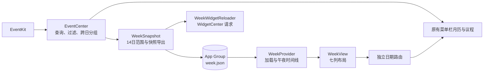

# Itsycal：本周日程小组件

状态：周起始日可配置、自动刷新已实现。开发签名构建、共享组快照、系统时间线和 Release 安装已跑通。后续日历编辑与全部交互场景仍需真机验收。

上游基线：`sfsam/Itsycal` commit `1a31050555a97e3b7aac5470ec147abfe7aa0d6a`（0.27.3）。本次基线要求 macOS 27.0；开发环境为 macOS 27.0.1、Xcode 27.1。

## 1. 用户目标与范围

用户已确认使用原生 macOS 桌面小组件，数据来自 Itsycal 已选日历中的日程；超出空间时显示剩余数量。后续视觉要求为合理、好看、极简，不复刻参考图。

- 显示包含今天的一周七天；每周起始日跟随 Itsycal 的“一周从周几开始”设置，七天同时可见。
- 每天日程放在对应列，按列表顺序排列，不做小时网格。
- 过去日期及其下面整列内容变暗；今天突出显示。
- 保留日历选择、完整当天列表入口、跨日事件和合理的失败状态。
- 首版不包含提醒事项、完成勾选、周导航、事件编辑、农历或节气。

## 2. 当前可见行为

### 日期和布局

支持 `systemMedium` 和 `systemExtraLarge` 两种原生横向尺寸，优先使用中号缩小桌面占用。系统不支持自定义外框为原宽度的三分之二：本机超大约 704 × 344 pt，中号约 344 × 164 pt。已有超大实例不会自动变小，需要用户切换尺寸或重新添加中号。

中号仅保留七列，无顶部信息行；星期在上、日期在下，采用 8 pt 内容边距。超大号保留“本周”、日期范围和总日程数的顶部行，星期日期同行，恢复 16 pt 内容边距、较大日期和原列间距。按 WidgetFamily 选择样式，不通过容器宽度猜测。两者均以蓝色圆角日期标识今天，过去整列弱化。

七列的第一列由 `WeekStartDOW` 决定（0=周日…6=周六），因此周一、周日或其他日期都可以是首列。修改设置后主应用重建共享快照并请求 WidgetCenter 刷新，不重建 App。日期运算使用本地 Calendar，覆盖跨月、跨年和夏令时；到达新的起始日时整体切换。

### 每日列表和容量

全天事件在前，随后沿用 EventCenter 排序的跨日/计时事件。计时事件按开始时间排列，相同开始时间以标题及事件标识稳定排序。

标题均为 10 pt 常规字重。中号时间 8 pt，时间在上、标题在下，每行 25 pt；超大号时间 9 pt，空间足够时时间标题同行，较窄时上下排列，每行 36 pt。标题一行省略，中号更容易截断长标题，可点击查看完整内容。

`WeekDates.capacity` 按列区实际高度与对应样式计算：中号日期及溢出预留 46 pt，超大号 54 pt，且所有尺寸每天最多四项。超大号顶部行在列区之外，不重复计算。中号约 148 pt 内容高度可容纳四项及溢出入口。超出显示剩余数量，无事件显示 `无日程`。不滚动，不截断数据数组。

过去日期整列 opacity 为 0.5，仍可点击。今天已结束的事件不在小组件中单独变暗。系统可重新着色或弱化整个小组件，今天的字重和圆角日期形状继续提供区别。

### 跨日事件

每个实际覆盖日生成独立片段，不绘制跨列长条。全天跨日片段显示“全天”；计时跨夜片段起始日显示 `22:00 →`，完整中间日显示“跨日”，结束日显示 `→ 02:00`。

结束边界为排他的 `[start, end)`：00:00 结束不占用结束日。零时长事件归入开始日。重复规则由 EventKit 生成实例；小组件不重新展开。

### 点击和主应用

点击日期、事件或溢出入口打开相应日期的完整日程。使用独立路由 `itsycal-week://date/yyyy-MM-dd?widget=1`。

主应用收到 widget 参数后暂时展示一天议程，即使原偏好把议程设为隐藏，也不覆盖该偏好。用户选择别的日期或改变议程设置后恢复常规行为。首次未授权/未选日历时打开主应用设置。

首版所有小组件共用主应用已选日历，不增加第二套配置。

## 3. 状态、刷新与限制

| 情况 | 当前行为 |
| --- | --- |
| 没有快照或读取/解码失败 | 保留日期外壳，提示打开 Itsycal 设置 |
| 日历未授权 | 不导出事件，提示打开主应用允许访问 |
| 没有已选日历 | 提示在主应用中选择日历 |
| 正常但无事件 | 七列显示“无日程” |
| 时区不匹配 | 提示打开主应用更新，不伪造当前时区的空日程 |
| 日期覆盖不足或桶缺失 | 提示获取本周日程 |
| 超过 24 小时未生成快照 | 保留可用列表，右下角显示可点击的刷新状态图标，无障碍说明数据可能过期 |
| 共享容器/写入失败 | 日志报告错误，保留上一个完整文件；扩展按已有快照或初始状态显示 |

EventCenter 是唯一事件查询、过滤、分日的 authority。主应用是唯一快照写入方，扩展只读；使用 JSON 原子替换，避免半写文件。

主应用事件变化、日历选择变化、一周起始日变化、跨日、时区/系统时钟变化、唤醒、重新激活时更新或重新查询数据，发布快照后请求 WidgetCenter 重载。

快照保留从当前起始日算起的本周和下周共 14 个本地日期，并携带 `weekStart`；不因菜单栏翻到其他月份而缺少本周。快照 schema 版本为 2。TimelineProvider 生成现在和未来 14 个本地午夜条目，并申请一小时后重载。日期状态按每条 timeline 的日期计算。

主应用退出后，已有快照可按 timeline 推进日期；新的日程编辑不会持续同步。超出 14 天覆盖或快照过期会明确提示。系统管理实际重载及渲染时机，不提供秒级同步或午夜精确到秒保证。日历变化撤权在主应用观察到后清除导出内容，不能承诺即时撤回系统已渲染的画面。

## 4. 架构与规则归属

| 义务 | Authority / interface | 验证 |
| --- | --- | --- |
| 事件查询、筛选、分日和缓存覆盖 | `EventCenter.m` | 真实实现 + 内存 EventKit store 检查 |
| 桌面 14 天范围、周起始读取、原子导出、权限状态 | `WeekSnapshot.m` / `WeekSnapshotInterval`、`PublishWeekSnapshot` | 构建、真实 interval 检查与本机共享组写入验证 |
| 可配置周起始、日期桶 key、覆盖校验、容量和链接 | `WeekModel.swift` / `WeekDates`、`WeekSnapshot.message` | Swift 离线检查 |
| 系统 timeline | `WeekWidget.swift` / `WeekProvider` | 构建、午夜日期生成检查；系统接受15条时间线 |
| 视觉、整列变暗、今天强调、溢出 | `WeekView.swift` | 浅/深色离线渲染与用户桌面添加实测 |
| 日期链接与完整当天入口 | `AppDelegate.m`、`ViewController.m` | 构建与静态调用链检查；点击待真机验证 |

现有 EventCenter 曾把未缓存日期范围的最后一天作为排他上界，可能漏查。现在在任何部分缺失时查询完整半开区间，并替换该范围的缓存；空桶用于清除旧条目，但不作为非空事件日发布给原议程。零时长事件也保留。

MoCalendar 绘制、Agenda 详情、会议 URL 提取及其他主应用功能保持原有模块归属。

## 5. Fork 身份与安装

这是可以与官方版共存的个人 fork：

- 主应用 bundle ID：`com.wutongyuonce.Itsycal`；显示名 `Itsycal`。
- 扩展 bundle ID：`com.wutongyuonce.Itsycal.WeekWidget`。
- URL scheme：`itsycal-week`。
- App Group 默认值：`group.com.wutongyuonce.Itsycal`，可经 Local.xcconfig 覆盖。
- 扩展启用 sandbox，主应用不为此迁移为沙盒应用。
- 禁用官方 Sparkle 更新与信息源，避免被上游构建覆盖。
- 保留 MIT 许可和上游署名。本项目独立演进，不再自动合并上游。

本机现使用用户创建的 Apple Development 身份，已补齐 Apple 官方 WWDR G3 中间证书。Local.xcconfig 中团队及团队前缀共享组匹配；Xcode Automatic signing 完成两个 target 的 Debug / Release 构建，无需手工创建 profile。安装后刷新 chronod 缓存，系统已实际启动扩展并成功获取时间线，containermanagerd 已批准共享组。具体操作与此前 ad-hoc 路线的有限结论见安装说明。

安装时应用文件名使用 `Itsycal.app`。构建产品名称仍为 Itsycal，以匹配现有源码与混编头。

具体命令见 [WEEK_WIDGET_SETUP.md](WEEK_WIDGET_SETUP.md)。

## 6. 验收与当前证据

已执行并通过：

- Release 主应用与嵌入扩展的完整签名构建、安装及系统时间线验证通过。
- `bash Tests/check-week.sh`：可配置周起始（周一/周日/周三）、跨年、夏令时 23 小时日、timeline 日期、容量、日期链接、缺失覆盖、时区变化、跨夜结束时间。
- 同一脚本运行真实 EventCenter 查询/分组方法，以内存 store 替代系统日历：交叠缓存、最后一天、跨夜、排他午夜、零时长、不重复。
- `Tests/RenderWeek.swift` 渲染实际 `WeekView`，输出浅色和深色样张；使用合成内容，不读取个人日历。
- plist 语法与 diff 空白检查。
- 完整功能改动的只读审查；更新安装的版本不匹配故障通过真实系统日志复现与恢复。

SourceKit 单文件诊断缺少 Xcode 跨文件构建上下文，会报告 WeekSnapshot/WeekDates 未定义等；完整 Xcode 编译已通过，以真实 target 编译为准。

尚未通过或未执行：

- 最新样式的全部交互确认。用户已确认能添加，系统成功启动开发签名扩展，接收 15 条时间线，超大容器大小为 704 × 344 pt。
- 日历后续编辑后的端到端同步；当前主应用已成功生成 ready 快照，包含完整 14 天日期桶。
- 桌面中的实际排版、深链接点击、睡眠后切周及系统刷新延迟。

完成上述真机检查后，才可宣称桌面可用版已验收。当前可评审代码、预览和离线检查已具备。

## 7. Sources

- [Itsycal 上游基线](https://github.com/sfsam/Itsycal/tree/1a31050555a97e3b7aac5470ec147abfe7aa0d6a)
- [Apple：systemExtraLarge](https://developer.apple.com/documentation/widgetkit/widgetfamily/systemextralarge)
- [Apple：Creating a widget extension](https://developer.apple.com/documentation/widgetkit/creating-a-widget-extension)
- [Apple：SwiftUI views for widgets](https://developer.apple.com/documentation/widgetkit/swiftui-views)
- [Apple：Keeping a widget up to date](https://developer.apple.com/documentation/widgetkit/keeping-a-widget-up-to-date)
- [Apple：Configuring app groups](https://developer.apple.com/documentation/xcode/configuring-app-groups)
